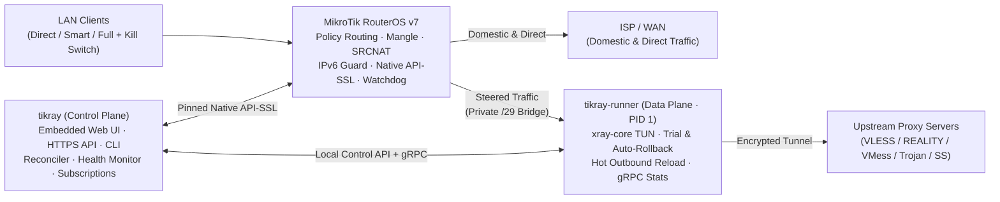

# tikray

[](https://github.com/Arman2122/tikray/actions/workflows/ci.yml)
[](https://github.com/Arman2122/tikray/actions/workflows/chr.yml)
[](LICENSE)
[](go.mod)
[](routeros/README.md)

**tikray** makes [xray-core](https://github.com/XTLS/Xray-core) a first-class, easy-to-install, and safe-to-update proxy client on **MikroTik RouterOS v7**.

It runs natively inside RouterOS containers with zero external hardware required: a hardened Go control plane (embedded Web UI, HTTPS REST API, CLI, and native RouterOS reconciler) paired with a minimal data-plane supervisor container that runs `xray-core` over TUN with trial-and-rollback safety.

---

## Architecture



Two containers share a single `/data` volume over a dedicated, reply-only ARP private bridge (`172.31.255.0/29` by default):

- **`tikray` (Control Plane)** — Holds desired state, renders version-gated xray configs, manages subscriptions and health probes, serves the embedded Web UI & HTTPS REST API, and continuously reconciles MikroTik RouterOS rules over a certificate-pinned native API-SSL session.
- **`tikray-runner` (Data Plane)** — Runs as PID 1 in a `FROM scratch` container (`CAP_NET_ADMIN` + `/dev/net/tun`), manages Linux policy routing inside the container, supervises `xray-core`, and applies every config or binary change via a deadline-backed trial with automatic rollback.

---

## Key Features

- **Hybrid Traffic Steering** — Domestic IPs/domains and local LAN traffic bypass the proxy directly at RouterOS speed; international traffic goes through `xray-core`. Per-device (`/32`) and per-subnet (`CIDR`) overrides support `direct`, `smart`, and `full` modes with optional **Kill Switch** and IPv6 leak protection.
- **Four Independent Update Lifecycles** — Update `xray-core`, Geo data (`iran`, `v2fly`, `loyalsoldier`, `custom`), the `tikray` control image (blue/green, zero traffic interruption), and `tikray-runner` independently — every switch verifies cryptographic digests/signatures, trials health end-to-end, and automatically rolls back on failure.
- **Zero-Downtime Hot Server Changes** — Adding, removing, enabling, or disabling servers hot-reloads outbounds through `xray api` without restarting `xray-core` or dropping active connections, with automatic trial fallback on error.
- **Embedded Offline-First Web UI** — Responsive Svelte 5 SPA compiled directly into the `tikray` Go binary (~57 KB gzipped, dark & light themes, zero external CDNs or fonts) featuring live SVG throughput charts, an interactive 4-stage traffic topology flow, `Ctrl+K` / `⌘K` command palette, and a client-side share-link inspector that loads instantaneously even on air-gapped networks.
- **First-Class Offline & Censored-Network Support** — Every update path supports upstream direct fetch, proxy fallback through the active tunnel, user mirrors, and an authenticated offline inbox (`/v1/inbox/*` or `disk1/tikray/data/inbox/`).
- **Encrypted Backup & Restore** — Export and restore full state (including server credentials and subscription URLs) sealed with **Argon2id + AES-256-GCM** (`tikray-backup-v1`), preserving managed bridge topology on restore.
- **RouterOS Operational Safety** — Scoped native API access, readback-verified reconciliation, RouterOS DHCP lease discovery & static lease conversion, automatic container watchdog, one-command `tikray-emergency-off`, and clean `keep`/`purge` uninstall.
- **Zero-Leak Secret Discipline** — Share links, server credentials, subscription URLs, passwords, setup codes, API tokens, session IDs, CSRF tokens, and RouterOS credentials never appear in API views, logs, events, error messages, or test output.

---

## Supported RouterOS & Hardware

### RouterOS Versions

| Channel | Versions | Status |
|---|---|---|
| **Stable** | `7.25.1` (and `7.25.x` point patches) | Lab-verified primary target (bare version format, DAI, VETH IP preserve, `/tool/fetch` & address-list fixes) |
| **Long-Term** | `7.24.6` (and `7.24.x` point patches) | Lab-verified |
| **Legacy Long-Term** | `7.23.8` (and `7.23.x` point patches) | Lab-verified |
| **Future Stable v7** | `7.26+` (canonical stable/long-term releases) | Forward-compatible (labeled `untested` in UI/status until verified in CHR CI) |

> Beta, RC, testing, development, RouterOS v6, and pre-`7.23.8` builds are refused by the version adapter and installer guard.

### Hardware & Architectures

- **ARM64 MikroTik routers** with RouterOS `container` package and USB/NVMe/internal ext4 storage (≥ 256 MB RAM recommended):
  - **hAP ax²**, **hAP ax³**, **hAP ax lite** (with storage), **RB5009UG+S+IN / RB5009UPr+S+IN**, **L009**, **Chateau 5G / LTE ax**, **CCR2004**, **CCR2116**, **CCR2216**, **CRS3xx/CRS5xx** (ARM64 models)
- **x86_64 & ARM64 CHR** (Cloud Hosted Router / x86 PCs / VMs)
- **xray-core**: tested up to **`v26.11.9`** (minimum `v26.1.18` with native TUN inbound).

---

## Quick Start

### Option 1: Install on MikroTik RouterOS (Recommended)

See the complete owner guide in [`routeros/README.md`](routeros/README.md) for prerequisites (enabling the `container` package, device-mode, and ext4 storage).

1. **Package a signed installer** from verified release archives (or download from GitHub Releases):
   ```sh
   go run ./cmd/tikray-installer \
     -version 7.25.1 \
     -arch arm64 \
     -images ./release-images \
     -key ./publisher.pub \
     -out ./install.rsc
   ```
2. **Import on MikroTik RouterOS**:
   - **Online (one-paste from your trusted HTTPS release origin):**
     ```routeros
     { :local dl [/tool/fetch url="https://<your-release-host>/install.rsc" check-certificate=yes http-max-redirect-count=0 dst-path=tikray-install.rsc as-value]; :if (($dl->"status") != "finished") do={ :error "Download failed" }; /import file-name=tikray-install.rsc }
     ```
   - **Offline (air-gapped / filtered networks):** Upload `install.rsc`, `tikray-arm64.tar`, `tikray-runner-arm64.tar`, and your staged xray-core zip into `disk1/tikray/`, then run:
     ```routeros
     :global tikrayCore "26.11.9"; :global tikrayOffline true; /import file-name=tikray-install.rsc
     ```
3. **Complete first-run setup**:
   - The installer prints the LAN HTTPS URL and self-signed TLS certificate SHA-256 fingerprint.
   - Retrieve your one-time setup code inside the control container:
     ```routeros
     /container/shell [find comment="tikray:ctl"] cmd="tikray setup-code"
     ```
   - Open the Web UI in your browser, enter the setup code, and create your administrator account.

### Option 2: Emergency Off & Clean Removal

- **Suspend all steering & kill switches immediately** (works even with both containers stopped):
  ```routeros
  /system/script/run tikray-emergency-off
  ```
- **Uninstall** (keeps `/data` by default so you can reinstall without losing servers or settings, or set `tikrayUninstallData="purge"`):
  ```routeros
  :global tikrayUninstallData "keep"; /import file-name=uninstall.rsc
  ```

---

## Web UI, CLI & REST API

Every management action works consistently through all three interfaces:

| Interface | How to Use |
|---|---|
| **Embedded Web UI** | Visit `https://<router-ip>` (or control container address). Manage Dashboard, Servers & Subscriptions, Devices & RouterOS DHCP Leases, Routing & DNS, 4-lifecycle Updates (with offline inbox upload), Live Events, API Tokens, and Encrypted Backups. |
| **CLI** | Run `tikray` inside the control container or remotely with `TIKRAY_API`, `TIKRAY_API_TOKEN`, and `TIKRAY_API_FINGERPRINT` pinned to the server certificate. |
| **HTTPS REST API** | JSON `/v1/*` endpoints with cookie+CSRF (browser) or Bearer token auth and optimistic concurrency (`ETag` / `If-Match`). See [`docs/api.md`](docs/api.md). |

### Common CLI Commands

```sh
tikray status                                              # Control, runner, xray & RouterOS status
tikray stats                                               # Live xray uptime, memory & per-tag traffic
tikray server add "vless://..."                            # Add server from share link
tikray sub add "https://provider.example/sub" --name main  # Add scheduled subscription feed
tikray device set 192.168.88.25 smart --kill-switch        # Assign per-device policy
tikray device make-static 192.168.88.25                    # Convert RouterOS DHCP lease to static
tikray policy default smart                                # Set LAN default policy
tikray core update latest                                  # Verify, trial & commit latest xray-core
tikray geo status                                          # Active geo slot & prefix count
tikray geo update latest --profile iran                    # Update geoip/geosite + domestic ranges
tikray image status tikray                                 # Check control/runner container images
tikray backup export --out backup.json                     # Encrypt full state (passphrase via env/stdin)
tikray backup restore --in backup.json                     # Decrypt & restore state atomically
tikray events                                              # Stream redacted control-plane events
tikray version                                             # Print build version
```

---

## Security Highlights

- **Certificate Pinning**: Both the RouterOS native API-SSL client and `tikray` CLI pin exact leaf certificate SHA-256 fingerprints.
- **Memory-Safe Cryptography**: Admin passwords and encrypted backups use Argon2id (`19 MiB, t=2, p=1`, bounded concurrency of 2 for router RAM safety) and AES-256-GCM.
- **Browser Hardening**: `Secure; HttpOnly; SameSite=Strict` session cookies, HMAC-SHA256 `X-Tikray-CSRF` tokens, strict Content-Security-Policy, and IP-bucketed login rate limiting (`429 Retry-After`).
- **Supply Chain Verification**: Container images verified via `cosign verify-blob` and chunked SHA-512 installer digests; `xray-core` zips verified against upstream `.dgst` or ECDSA P-256 signed hash indexes; symlink-safe `O_NOFOLLOW` atomic file updates throughout.

See [`SECURITY.md`](SECURITY.md) and [`docs/architecture.md`](docs/architecture.md) for the full threat model and security policy.

---

## Building & Testing from Source

`tikray` targets Linux containers (uses Linux netlink and `flock`). On Windows, develop and run Go builds inside **WSL2 Ubuntu**.

```sh
# Install Go / lab dependencies on Ubuntu / WSL2
scripts/dev-setup.sh

# Run Go vet and unit tests
make test

# Run race detector across control plane and internal packages
make race

# Type-check and rebuild the embedded Svelte 5 Web UI (requires Node 20+)
make ui

# Build RouterOS-compatible container image tarballs (requires Docker classic image store)
make images

# Run xray-core compatibility suite against real upstream releases (requires root)
sudo --preserve-env=PATH,HOME,GOPATH,GOMODCACHE,GOCACHE \
  go test -tags compat -count=1 ./test/compat/...
```

---

## Documentation

- [`docs/architecture.md`](docs/architecture.md) — Deep dive into container topology, RouterOS reconciliation, trial/rollback, and security boundaries
- [`docs/api.md`](docs/api.md) — Complete HTTPS REST API v1 reference
- [`routeros/README.md`](routeros/README.md) — MikroTik installation, offline deployment, emergency-off, watchdog, and removal guide
- [`docs/superpowers/specs/2026-10-24-tikray-design.md`](docs/superpowers/specs/2026-10-24-tikray-design.md) — Binding v1.0 design specification
- [`CONTRIBUTING.md`](CONTRIBUTING.md) — Contribution guidelines and testing checklist
- [`CHANGELOG.md`](CHANGELOG.md) — Release history

---

## License

`tikray` is licensed under the **GNU General Public License v3.0** — see [`LICENSE`](LICENSE).

`xray-core` is licensed separately under **MPL-2.0** by Project X; `tikray` never bundles `xray-core` binaries into its source tree or container images and downloads/verifies official releases independently at runtime.
