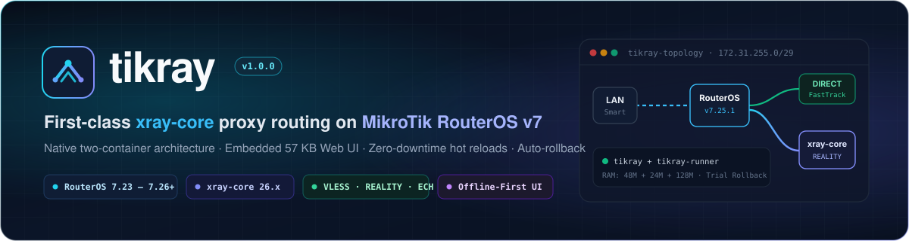
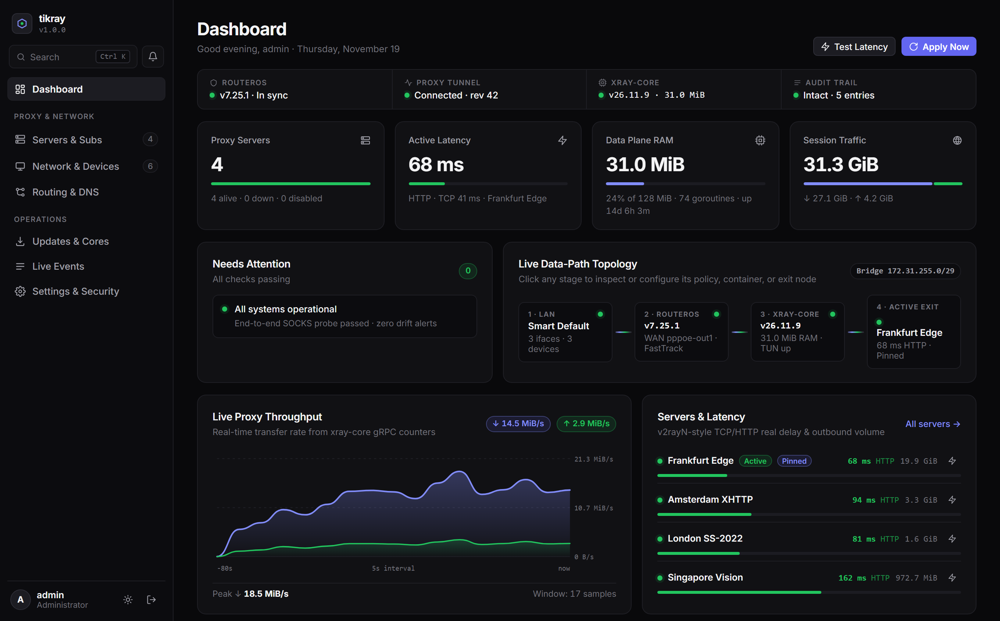
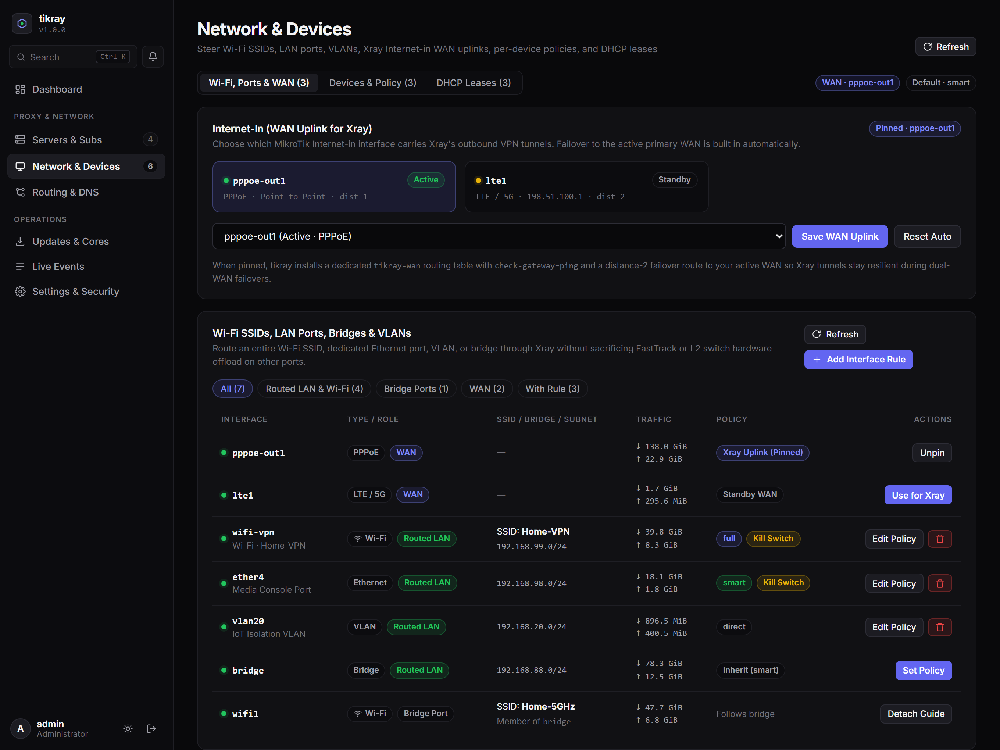
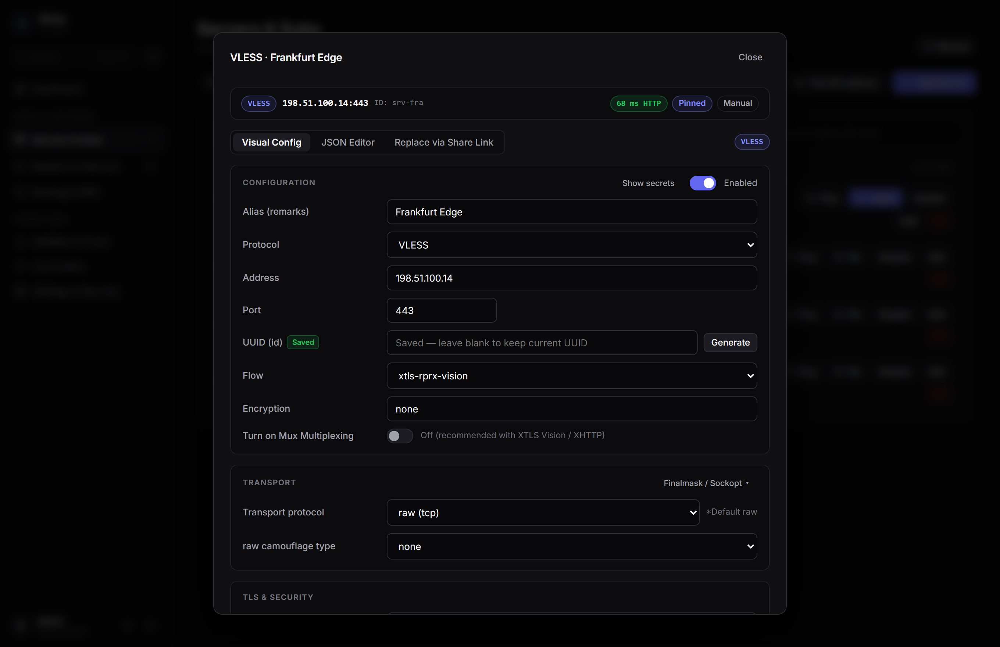
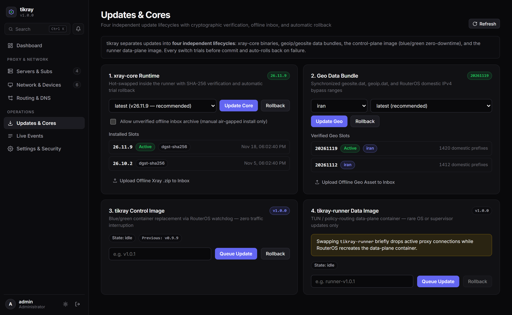
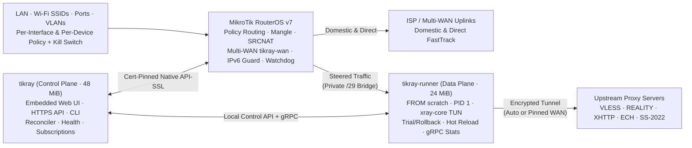

<div align="center">

<picture>
  <source media="(prefers-color-scheme: dark)" srcset="docs/assets/banner-dark.svg" />
  <source media="(prefers-color-scheme: light)" srcset="docs/assets/banner-light.svg" />
  
</picture>

<br/>

[](https://github.com/Arman2122/tikray/actions/workflows/ci.yml)
[](https://github.com/Arman2122/tikray/actions/workflows/chr.yml)
[](LICENSE)
[](go.mod)
[](docs/wiki/Installation-Guide.md)
[](docs/wiki/Protocols-and-Share-Links.md)
[](docs/wiki/Web-UI-and-CLI-Guide.md)

<p align="center">
  <strong>Turn any container-capable MikroTik RouterOS v7 router into a hardened, self-healing <a href="https://github.com/XTLS/Xray-core">xray-core</a> gateway — zero external hardware required.</strong>
</p>

<p align="center">
  <a href="#why-tikray">Why tikray</a> &nbsp;·&nbsp;
  <a href="#embedded-web-ui">Web UI</a> &nbsp;·&nbsp;
  <a href="#wi-fi-lan-ports--multi-wan-routing">Wi-Fi &amp; WAN</a> &nbsp;·&nbsp;
  <a href="#architecture">Architecture</a> &nbsp;·&nbsp;
  <a href="#protocols--xray-core-26x">Protocols</a> &nbsp;·&nbsp;
  <a href="#supported-routeros--hardware">Hardware</a> &nbsp;·&nbsp;
  <a href="#quick-start">Quick Start</a> &nbsp;·&nbsp;
  <a href="docs/wiki/Home.md">Wiki</a> &nbsp;·&nbsp;
  <a href="docs/releases/v1.0.1.md">Release Notes</a>
</p>

</div>

---

## Why tikray?

Running `xray-core` directly on a MikroTik router usually means fragile shell scripts, broken firewall rules after a RouterOS upgrade, leaked IPv6/DNS traffic, or bricked LAN internet after a bad config edit. **tikray** solves all of it as an integrated, defense-in-depth control and data plane built specifically for RouterOS v7.

| Capability | DIY Xray Container | Separate Linux Box / Pi | **tikray** |
|---|:---:|:---:|:---:|
| Zero extra hardware (native RouterOS containers) | ✅ | ❌ | ✅ |
| Domestic & LAN traffic offloaded at RouterOS FastTrack speed | Manual | Partial | **Automatic** |
| Per-**Wi-Fi SSID**, **LAN port**, **VLAN**, &amp; **device** policies + **Kill Switch** | ❌ | Manual | **Built-in + RouterOS Discovery** |
| Multi-WAN **Internet-in uplink pinning** for Xray tunnels with failover | ❌ | Manual | **Automatic (`tikray-wan` FIB)** |
| **v2rayN-style Visual Config + JSON Editor** &amp; warm HTTP 204 ping | ❌ | Separate app | **Built-in (auto-ping on connect)** |
| Automatic **trial & rollback** on bad config or `xray-core` upgrade | ❌ | ❌ | **Deadline-backed** |
| Zero-downtime **hot outbound reload** (no dropped connections) | ❌ | Manual | **Automatic (`xray api`)** |
| Native RouterOS **watchdog** & one-command **`tikray-emergency-off`** | ❌ | ❌ | **Built-in (works offline)** |
| Offline-first responsive Web UI (86 KB gz, zero CDNs) + CLI + HTTPS API | ❌ | Heavy | **Embedded in binary** |
| Air-gapped / censored-network **offline inbox** & proxy fallback | ❌ | Manual | **First-class** |
| Passphrase-encrypted portable backup (**Argon2id + AES-256-GCM**) | ❌ | Manual | **Built-in** |
| Cryptographic verification (`cosign`, SHA-512 chunks, ECDSA P-256) | ❌ | Manual | **Enforced end-to-end** |

---

## Embedded Web UI

Compiled directly into the `tikray` Go binary via `go:embed` (**86 KB total gzipped** across HTML + CSS + JS), the Obsidian-styled Svelte 5 SPA ships with **zero external fonts, CDNs, or telemetry** so it opens instantaneously on desktop, tablet, and mobile devices even on air-gapped or heavily filtered networks — in both dark and light themes.

<div align="center">
  <picture>
    <source media="(prefers-color-scheme: dark)" srcset="docs/assets/dashboard-dark.png" />
    <source media="(prefers-color-scheme: light)" srcset="docs/assets/dashboard-light.png" />
    
  </picture>
</div>

<br/>

<table>
  <tr>
    <td width="50%" valign="top">
      <strong>Observability &amp; Real Latency</strong><br/>
      • <strong>Live SVG Throughput Charts</strong> — smooth interactive download/upload rate curves from <code>/v1/stats</code> deltas with hover/touch scrubbing (zero charting libs).<br/>
      • <strong>Interactive 4-Stage Topology</strong> — live <code>LAN &amp; Interfaces → RouterOS v7 &amp; WAN → xray-core → Active Exit</code> map.<br/>
      • <strong>Warm HTTP 204 &amp; TCP Latency</strong> — v2rayN-style real tunnel latency measured automatically on every server connect and via 1-click <strong>Test Latency</strong>.
    </td>
    <td width="50%" valign="top">
      <strong>Operator Workflow</strong><br/>
      • <strong>v2rayN-Style Config &amp; JSON Editor</strong> — edit VLESS, VMess, Trojan, Shadowsocks 2022, REALITY, XHTTP <code>extra</code>, Mux, and raw JSON with secret-preserving saves.<br/>
      • <strong>Wi-Fi, Ports &amp; Multi-WAN Control</strong> — discover live MikroTik radios, Ethernet ports, VLANs, and WAN uplinks, plus 1-click RouterOS v7 CLI provisioning recipes.<br/>
      • <strong><code>Ctrl+K</code> Command Palette &amp; 4-Lifecycle Updates</strong> — pick <code>xray-core</code> versions from a dropdown, upload offline inbox archives, or pin exits from the keyboard.
    </td>
  </tr>
</table>

### Feature Gallery

<table>
  <tr>
    <td width="50%" valign="top">
      <a href="docs/assets/network-interfaces-dark.png">
        
      </a>
      <p align="center"><sub><strong>Network &amp; Devices</strong> — Live MikroTik Wi-Fi SSIDs, LAN ports, VLANs, per-interface policies &amp; Xray WAN uplink pinning.</sub></p>
    </td>
    <td width="50%" valign="top">
      <a href="docs/assets/server-editor-dark.png">
        
      </a>
      <p align="center"><sub><strong>Server Config &amp; JSON Editor</strong> — Visual form synced two-way with raw <code>xray-core</code> JSON, Share Link unpacker &amp; saved-secret indicators.</sub></p>
    </td>
  </tr>
  <tr>
    <td colspan="2" valign="top">
      <a href="docs/assets/updates-dark.png">
        
      </a>
      <p align="center"><sub><strong>Updates &amp; Cores</strong> — <code>xray-core</code> release picker dropdown (<code>latest</code> + verified slots), Geo bundles, blue/green control &amp; runner image lifecycles, and offline inbox staging.</sub></p>
    </td>
  </tr>
</table>

---

## Wi-Fi, LAN Ports & Multi-WAN Routing

Real MikroTik deployments rarely treat every port and SSID the same. **tikray** models your router's actual Layer-3 topology natively in RouterOS v7:

- **Dedicated VPN Wi-Fi SSIDs & LAN Ports** — Assign `Direct`, `Smart Split`, or `Full Tunnel` (with optional **Kill Switch** and matching IPv6 leak guard) to any routed Wi-Fi interface (e.g. `wifi-vpn` broadcasting `Home-VPN`), dedicated Ethernet port (`ether4` for Apple TV / PS5), VLAN (`vlan20`), or bridge — while keeping L2 switch-chip hardware offload and FastTrack completely intact on your main LAN.
- **Built-In RouterOS v7 Setup Recipes** — For bridged ports or main Wi-Fi radios, the Web UI generates copy-paste RouterOS v7 CLI commands (supporting both modern `/interface/wifi` WiFiWave2 and legacy `/interface/wireless`) to spin up a dedicated VPN SSID or detach a LAN port onto its own subnet and DHCP server, then stages its policy in one click.
- **Internet-In (WAN Uplink) Pinning** — On single- or multi-WAN routers (`ether1`, `pppoe-out1`, `lte1`, fiber + 5G backup), **tikray** discovers all active and standby default routes and lets you either follow the active WAN automatically (**Auto**, zero extra rules) or pin Xray's outbound tunnels to a specific WAN interface via a dedicated `tikray-wan` FIB table (`check-gateway=ping` + automatic distance-2 failover).
- **Precedence Order** — `Per-Device / CIDR Override` → `Interface Policy (Wi-Fi / Port / VLAN)` → `Default LAN Policy`.

---

## Architecture

Two hardened Linux containers share one `/data` volume across an isolated, reply-only ARP private `/29` bridge (`172.31.255.0/29` by default):



### Router-Friendly Memory Budget

| Component | Base Image | Memory Guard | Role |
|---|---|---|---|
| **`tikray`** | `busybox:1.37.0-musl` + static Go | `GOMEMLIMIT=48MiB` | Web UI, HTTPS API, CLI, RouterOS reconciler, interface discovery, subscriptions, health monitor |
| **`tikray-runner`** | **`FROM scratch`** + static Go | `GOMEMLIMIT=24MiB` | PID 1 supervisor, netlink TUN/routing, deadline-backed trials (no shell) |
| **`xray-core`** | Downloaded & verified onto `/data` | `XRAY_GOMEMLIMIT=128MiB` | High-throughput proxy data plane (`CAP_NET_ADMIN` + `/dev/net/tun`) |

> Because `tikray` and `tikray-runner` are separate containers, upgrading `tikray` runs **blue/green with zero traffic interruption**, while `tikray-runner` carries zero RouterOS credentials and zero public listening ports.

---

## Protocols & `xray-core` 26.x

Tested from **`xray-core v26.1.18`** through **`v26.11.9`**, with automatic version-gated rendering and strict security policy checks (`internal/xraypolicy`):

| Protocol / Capability | Share-Link Support | Details |
|---|---|---|
| **VLESS** | `vless://` | `xtls-rprx-vision`, raw/TCP, WS, gRPC, HTTPUpgrade, **XHTTP** (`splithttp`), and **Post-Quantum VLESS `encryption`** pass-through |
| **REALITY + Post-Quantum** | `security=reality` | Full `pbk`, `sid`, `spx`, uTLS `fp`, plus **ML-DSA-65 verification (`pqv` → `mldsa65Verify`)** |
| **XHTTP Advanced (`extra`)** | `type=xhttp&extra={…}` | Full JSON object support (XMUX, `downloadSettings`, `noGRPCHeader`, padding; 16 KiB cap, zero secret echo, nested `allowInsecure` blocked) |
| **TLS + ECH + Cert Pinning** | `security=tls` | **TLS Encrypted Client Hello (`ech` → `echConfigList`)**, pinned cert SHA-256 (`pcs`), custom verify name (`vcn`), ALPN, CDN host fallback |
| **VMess / Trojan / SS** | `vmess://`, `trojan://`, `ss://` | Standard & **Shadowsocks 2022** (with key-length validation); unsafe plaintext/no-TLS outbounds and deprecated `allowInsecure` are refused cleanly |
| **Visual & Raw JSON Editor** | `--json FILE` / Web UI | v2rayN-style Visual Config editor synced two-way with raw `xray-core` outbound JSON (including experimental transports and `finalmask`) |
| **Subscriptions** | Scheduled + Manual | Base64, plain-line, and SIP008 feeds with diff summaries (`added / updated / removed / kept / skipped`) and never-leaked URLs |

---

## Supported RouterOS & Hardware

### MikroTik RouterOS v7 Matrix

| Release Channel | Versions | Status |
|---|---|---|
| **Stable** | **`7.25.1`** (and `7.25.x` point patches) | Lab-verified primary target (bare version format, DAI, VETH IP preserve, `/tool/fetch` & address-list fixes) |
| **Long-Term** | **`7.24.6`** (and `7.24.x` point patches) | Lab-verified |
| **Legacy Long-Term** | **`7.23.8`** (and `7.23.x` point patches) | Lab-verified |
| **Future Stable v7** | **`7.26+`** (canonical stable/long-term releases) | Forward-compatible (marked with a non-blocking `untested` badge in `/v1/status` & UI until verified in CHR CI) |

> Pre-releases (`beta`, `rc`, `testing`, `development`), `.0` patches, RouterOS v6, and pre-`7.23.8` builds are strictly refused by the version adapter and installer guard.

### Hardware Tiers

| Tier | Recommended Models | Notes |
|---|---|---|
| **Home / Entry (256–512 MB RAM)** | **hAP ax²**, **hAP ax³**, **hAP ax lite** (USB/storage), **L009**, **Chateau 5G / LTE ax** | ARM64 + ext4 USB/internal storage; fits smoothly within default `GOMEMLIMIT` budgets |
| **Prosumer / Power User (1 GB RAM)** | **RB5009UG+S+IN**, **RB5009UPr+S+IN**, **CRS3xx / CRS5xx** (ARM64) | High throughput with FastTrack domestic offload + USB 3.0 / NVMe storage |
| **Enterprise & Virtual** | **CCR2004**, **CCR2116**, **CCR2216**, **x86_64 & ARM64 CHR** | Multi-gigabit routing capacity; `amd64` and `arm64` images built identically |

---

## Quick Start

> **Prerequisites on MikroTik RouterOS v7 (`7.23.8+`, `7.24.6+`, or `7.25.x`):** install the matching MikroTik `container` extra package, enable container `device-mode` (`/system/device-mode/update container=yes`), enable router DNS (`/ip/dns/set allow-remote-requests=yes`), and have an ext4-formatted disk mounted (`disk1` by default — check `/disk/print`). See the full [**Installation Guide**](docs/wiki/Installation-Guide.md) for step-by-step preparation.

### 1. Fast Install Directly on MikroTik (No Go or PC Required)

Open **WinBox → New Terminal** (or SSH to your router) and paste these two commands:

```routeros
/tool/fetch url="https://github.com/Arman2122/tikray/releases/latest/download/bootstrap.rsc" dst-path="tikray-bootstrap.rsc"
/import file-name="tikray-bootstrap.rsc"
```

**What this does automatically:**
- Detects your router architecture (`arm64` or `x86_64` CHR) and RouterOS v7 release line (`7.25.x`, `7.24.6+`, or `7.23.8+`), checking prerequisites before downloading anything.
- Downloads the matching signed `tikray-<arch>.tar`, `tikray-runner-<arch>.tar`, and pre-packaged `install-<line>-<arch>.rsc` directly onto your ext4 disk (`disk1`), avoiding internal flash wear.
- Runs the verified installer, which checks every **16 KiB SHA-512 chunk** and Cosign public key before creating the isolated private bridge, firewall rules, API-SSL cert pin, containers, watchdog, and bringing up the Web UI.

<details>
<summary><strong>Customize Disk, Subnet, LAN/WAN Lists, Mirror URL, or Enforce TLS CA Check</strong></summary>

Set any optional global variable in the **same terminal session** before running `/import file-name="tikray-bootstrap.rsc"`:

```routeros
:global tikrayDisk "usb1"                  # default: "disk1" (ext4 mount-point from /disk/print)
:global tikraySubnet "172.31.254.0/29"     # default: "172.31.255.0/29"
:global tikrayLanList "LAN"                # default: "LAN"
:global tikrayWanList "WAN"                # default: "WAN"
:global tikrayCheckCert true               # enforce RouterOS CA verification (if Mozilla CAs are imported)
# :global tikrayBaseURL "https://mirror.example/tikray"  # optional HTTPS mirror
/import file-name="tikray-bootstrap.rsc"
```

</details>

<details>
<summary><strong>Air-Gapped / Censored-Network Offline Install (Still No Go Required)</strong></summary>

Download `install-<line>-<arch>.rsc`, `tikray-<arch>.tar`, and `tikray-runner-<arch>.tar` from [**GitHub Releases**](https://github.com/Arman2122/tikray/releases/latest) (verify with `SHA256SUMS` + `publisher.pub`), upload the `.tar` files to `disk1/tikray/images/` and `install-*.rsc` to `disk1/tikray-install.rsc` via WinBox/WebFig (plus the upstream `xray-core` zip and signed `index.json` into `disk1/tikray/data/inbox/`), then run:

```routeros
:global tikrayCore "26.11.9"; :global tikrayOffline true; /import file-name="disk1/tikray-install.rsc"
```

See the full [**Offline & Censored Networks Guide**](docs/wiki/Offline-and-Censored-Networks.md) for staging details.

</details>

<details>
<summary><strong>Advanced: Package Manually with Go (Custom Signing Key, Non-Redirecting HTTPS Mirror, or RouterOS 7.26+)</strong></summary>

If you want to package an installer from source with your own Cosign key, target a custom non-redirecting HTTPS static mirror (`-release-base`), or generate an installer for a newer `7.26+` RouterOS branch:

```sh
go run ./cmd/tikray-installer \
  -version 7.25.1 \
  -arch arm64 \
  -images ./release-images \
  -key ./publisher.pub \
  -out ./install.rsc
```

See [`routeros/README.md`](routeros/README.md) for full packager options.

</details>

### 2. Claim Administrator & Open Web UI

At completion, the installer prints the LAN HTTPS URL (for example `https://172.31.255.2/`) and the self-signed TLS certificate SHA-256 fingerprint. Fetch your one-time setup code inside the control container:

```routeros
/container/shell [find comment="tikray:tikray"] cmd="tikray setup-code"
```

Open the printed HTTPS URL in your browser, compare the certificate SHA-256 fingerprint, enter the setup code, and create your admin account.

### 3. Emergency Off & Clean Removal

<details>
<summary><strong>Emergency Off (Works Even With Both Containers Stopped) &amp; Fast Keep/Purge Uninstall</strong></summary>

```routeros
# Immediately suspend all steering & kill switches while keeping your owner firewall intact:
/system/script/run tikray-emergency-off

# Download the official uninstaller directly on MikroTik:
/tool/fetch url="https://github.com/Arman2122/tikray/releases/latest/download/uninstall.rsc" dst-path="tikray-uninstall.rsc"

# Clean uninstall — keeps /data (servers, admin, TLS identity, core slots) by default:
:global tikrayUninstallData "keep"; /import file-name="tikray-uninstall.rsc"

# Full removal including /data:
:global tikrayUninstallData "purge"; /import file-name="tikray-uninstall.rsc"
```

</details>

---

## CLI & HTTPS API Cheat Sheet

Every operation works through the **Embedded Web UI**, the **`tikray` CLI** (local container or remote via `TIKRAY_API` + `TIKRAY_API_TOKEN` + `TIKRAY_API_FINGERPRINT`), and the **HTTPS REST API v1** ([`docs/api.md`](docs/api.md)):

```sh
tikray status                                              # Control, runner, xray & RouterOS status
tikray stats                                               # Live xray uptime, heap memory & per-tag traffic
tikray server add "vless://..."                            # Add server from share link (or --json FILE)
tikray sub add "https://provider.example/sub" --name main  # Add scheduled subscription feed
tikray device set 192.168.88.25 smart --kill-switch        # Assign per-device or CIDR policy
tikray device make-static 192.168.88.25                    # Convert bound RouterOS DHCP lease to static
tikray policy default smart                                # Set LAN default policy (direct|smart|full)
tikray core update latest                                  # Verify, trial & commit latest xray-core
tikray geo update latest --profile iran                    # Update geoip/geosite + RouterOS domestic CIDRs
tikray image update tikray v1.0.1                          # Blue/green container upgrade via watchdog
tikray backup export --out backup.json                     # Encrypt full state (Argon2id + AES-256-GCM)
tikray backup restore --in backup.json                     # Atomic restore (preserves managed bridge subnet)
tikray events                                              # Stream redacted control-plane events
```

Key HTTPS REST API v1 endpoints also include `GET /v1/routeros/interfaces`, `PUT /v1/interfaces/{name}`, `DELETE /v1/interfaces/{name}`, `PUT /v1/network/wan`, `GET /v1/servers/{id}/config`, `POST /v1/servers/{id}/ping`, and `GET /v1/core/releases` — see [`docs/api.md`](docs/api.md).

---

## Security & Supply-Chain Hardening

- **Zero-Secret Discipline** — Share links, server UUIDs/passwords, subscription URLs, Wi-Fi passphrases, root/named API tokens, passwords/hashes, setup codes, session IDs, CSRF tokens, backup passphrases, and RouterOS API credentials never reach API views, logs, events, history files, or error messages. Editing an existing server preserves stored secrets via a non-secret sentinel unless explicitly rotated.
- **Certificate Pinning Everywhere** — Both the RouterOS native API-SSL reconciler and remote `tikray` CLI pin exact leaf SHA-256 certificate fingerprints.
- **Memory-Bounded Cryptography** — Admin passwords and portable `tikray-backup-v1` archives use **Argon2id** (`19 MiB, t=2, p=1`, concurrency capped at 2 for constrained router RAM) + **AES-256-GCM**.
- **Browser Defense** — `Secure; HttpOnly; SameSite=Strict` cookies, HMAC-SHA256 `X-Tikray-CSRF` headers, strict CSP, `ETag`/`If-Match` optimistic concurrency, and IP/global login rate limiting (`429 Retry-After`).
- **Verified Artifacts** — Container images verified via `cosign verify-blob` and 16 KiB chunked SHA-512 digests; `xray-core` zips verified against upstream `.dgst` or ECDSA P-256 signed hash indexes; symlink-safe `O_NOFOLLOW` atomic writes throughout.

Read the full threat model in [`SECURITY.md`](SECURITY.md) and [`docs/architecture.md`](docs/architecture.md).

---

## Documentation & Wiki

| Guide | What It Covers |
|---|---|
| [**Wiki Home**](docs/wiki/Home.md) | Complete indexed knowledge base for operators & contributors |
| [**Installation Guide**](docs/wiki/Installation-Guide.md) | RouterOS prerequisites, storage, online install, installer variables & first-run setup |
| [**Offline & Censored Networks**](docs/wiki/Offline-and-Censored-Networks.md) | Air-gapped staging, Web UI offline inbox, proxy-fallback updates & custom mirrors |
| [**Protocols & Share Links**](docs/wiki/Protocols-and-Share-Links.md) | VLESS, REALITY, ML-DSA-65 `pqv`, XHTTP `extra`, TLS ECH, `pcs`/`vcn`, SS-2022 & raw JSON |
| [**Traffic Steering & Policies**](docs/wiki/Traffic-Steering-and-Policies.md) | `direct`/`smart`/`full`, Kill Switch, IPv6 guard, DHCP static leases & NAT/FastTrack rules |
| [**Web UI & CLI Guide**](docs/wiki/Web-UI-and-CLI-Guide.md) | Every UI view, `Ctrl+K` shortcuts, complete CLI commands & environment variables |
| [**Updates, Watchdog & Rollbacks**](docs/wiki/Updates-Watchdog-and-Rollbacks.md) | 4 update lifecycles, trials, hot reloads, native watchdog & encrypted backup/restore |
| [**Performance & Hardware Tuning**](docs/wiki/Performance-and-Hardware-Tuning.md) | Router sizing, `GOMEMLIMIT` tuning, FastTrack offload & flash wear minimization |
| [**Troubleshooting & Emergency Recovery**](docs/wiki/Troubleshooting-and-Emergency-Recovery.md) | `tikray-emergency-off`, password reset, bridge/NAT repair, `keep`/`purge` uninstall |
| [**FAQ**](docs/wiki/FAQ.md) | Quick answers to the most common architectural & operational questions |
| [**Architecture Deep Dive**](docs/architecture.md) · [**REST API v1**](docs/api.md) | Technical internals, reconciliation lifecycle & full JSON endpoint specification |
| [**v1.0.1 Release Notes**](docs/releases/v1.0.1.md) · [**Changelog**](CHANGELOG.md) | Release highlights, artifact verification commands & version history |

---

## Building & Testing from Source

`tikray` targets Linux containers (`netlink`, `flock`, `O_NOFOLLOW`). On Windows, build and test inside **WSL2 Ubuntu**:

```sh
scripts/dev-setup.sh                  # Install Go toolchain & verify baseline on Ubuntu / WSL2
make test                             # Run go vet and full unit test suite
make race                             # Run Go race detector across cmd/ and internal/
make ui                               # Type-check (0 errors/warnings) and rebuild embedded Svelte 5 UI
make images                           # Build RouterOS-compatible classic-store Docker image tarballs
make build VERSION=v1.0.0             # Compile stripped static Linux binaries into ./out/
```

See [`CONTRIBUTING.md`](CONTRIBUTING.md) and [`CODE_OF_CONDUCT.md`](CODE_OF_CONDUCT.md) before opening a pull request.

---

## License

`tikray` is free and open-source software licensed under the **GNU General Public License v3.0** — see [`LICENSE`](LICENSE).

[xray-core](https://github.com/XTLS/Xray-core) is licensed separately under **MPL-2.0** by Project X. `tikray` never bundles `xray-core` binaries into its source tree or container images; official releases are fetched and cryptographically verified at runtime or staged via the offline inbox.
